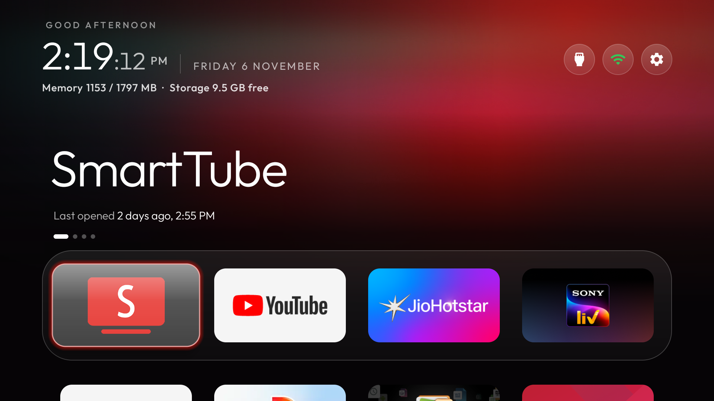
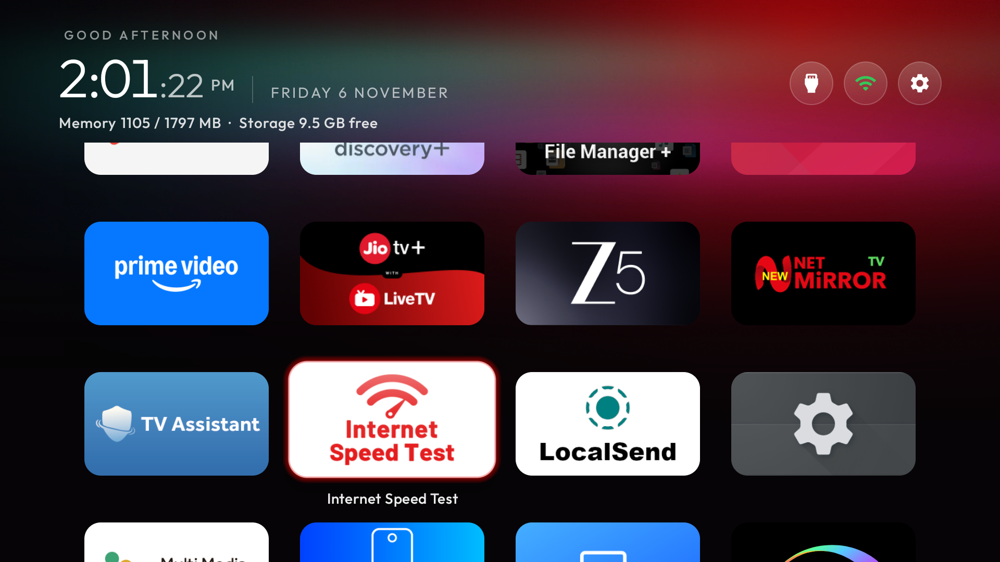

<div align="center">
  
</div>

<p align="center">
  <a href="https://github.com/emmanuel11003"></a>
  <a href="https://github.com/emmanuel11003/cleanyourtv"></a>
  <a href="https://github.com/emmanuel11003"></a>
  <a href="https://github.com/emmanuel11003"></a>
</p>

---

### 👨‍💻 Executive Summary

Software developer specializing in **Android TV OS internals, embedded low-latency UI engineering, and firmware-level debloating**. Focused on extracting maximum framerate, responsiveness, and aesthetic clarity from memory-constrained Android smart TV hardware (MediaTek SoCs).

- 🔭 **Lead Developer**: Custom fork & hardware architecture for [CleanYourTV (Haier 55" Platform)](https://github.com/emmanuel11003/cleanyourtv).
- ⚡ **Core Philosophy**: Zero-bloat architectures, sub-frame input responsiveness, and hardware-accelerated minimalist design.
- 🎯 **Target Device**: Haier 55P7GT-P / HR9676EU (Board: `omonia` / MediaTek, Google TV 14).

---

## 📺 Flagship Project: CleanYourTV (Haier 55" Edition)

> Built on top of the open-source [Gathin23/cleanyourtv](https://github.com/Gathin23/cleanyourtv) baseline, fully re-engineered and tuned for real-world production use on 55" 4K Google TV 14 displays.

<div align="center">
  <table border="0" cellspacing="10" cellpadding="0">
    <tr>
      <td colspan="2" align="center">
        <a href="https://github.com/emmanuel11003/cleanyourtv">
          
        </a>
        <br>
        <sub><b>Primary Interface:</b> Hardcoded Aurora Glass Theme, Dynamic Status Bar, and 5-Column Responsive App Dock</sub>
      </td>
    </tr>
    <tr>
      <td width="50%" align="center">
        
        <br>
        <sub><b>Dock Architecture:</b> 5-Column layout calibrated for 55" D-Pad remote navigation</sub>
      </td>
      <td width="50%" align="center">
        
        <br>
        <sub><b>Engineered Transitions:</b> 0.5x duration scales with zero icon flash or pop-up latency</sub>
      </td>
    </tr>
  </table>
</div>

---

### 🛠️ Architecture & Engineering Highlights

```
┌────────────────────────────────────────────────────────────────────────┐
│                        HAIER 55P7GT-P PLATFORM                         │
├──────────────────────┬───────────────────────┬─────────────────────────┤
│    THEME & DOCK      │ PERFORMANCE TUNING    │    SUBSYSTEM FIXES      │
├──────────────────────┼───────────────────────┼─────────────────────────┤
│ • Permanent Aurora   │ • 0.5x System Scale   │ • Fixed Clock Baseline  │
│ • Transparent Glass  │ • Instant App Launch  │ • Digit Ghosting Solved │
│ • 5-Column Geometry  │ • No Window Pop-up    │ • Idle Thread Pauses    │
│ • Zero Background UI │ • Eliminated Icon Lag │ • Hardened Dock Bounds  │
└──────────────────────┴───────────────────────┴─────────────────────────┘
```

| Area | Engineering Implementation & Optimization |
| :--- | :--- |
| **Theme Engine** | Built-in permanent **Aurora Theme** defaults featuring translucent card backings, custom wallpaper gradients, and zero background render overhead. |
| **Motion & Latency** | Hardcoded **0.5x animation scales** across window, transition, and animator durations to cut interface traversal latency in half on MediaTek processors. |
| **Task Lifecycle** | Neutralized standard Android 14 task launch artifacts; eliminated the previous application's ghost icon flash when switching tasks via remote. |
| **LiveClock Core** | Patched typeface baseline clipping and simultaneous dual-digit rendering; integrated lifecycle listeners to pause clock tick threads during background states. |
| **System Hygiene** | Implemented non-destructive package disabling for background retail demo services (`com.mediatek.tv.retaildemo`) without root or partition modification. |

---

### 🧰 Technical Proficiency

<div align="center">

| Domain | Technologies & Tooling |
| :--- | :--- |
| **Operating Systems** | `Android TV (Pie → 14)` `Google TV` `Linux / Shell` `Windows CLI` |
| **Languages & Core** | `Java (Android SDK)` `Python` `Bash` `PowerShell` `XML Layouts` |
| **Diagnostics & Tools**| `Android Debug Bridge (ADB)` `Logcat` `Sysrace` `Git` `GitHub Actions` |
| **Hardware Targets** | `MediaTek Smart TV SoCs` `Amlogic` `Realtek Embedded` |

</div>

---

### 📈 GitHub Analytics

<div align="center">
  <table border="0" cellspacing="0" cellpadding="0">
    <tr>
      <td>
        
      </td>
      <td>
        
      </td>
    </tr>
  </table>
</div>

---

<div align="center">
  <sub>Maintained by <b>Emmanuel J Joseph</b> • Code licensed under <a href="https://github.com/emmanuel11003/cleanyourtv/blob/main/LICENSE">MIT</a> • Upstream base: <a href="https://github.com/Gathin23/cleanyourtv">Gathin23/cleanyourtv</a></sub>
</div>
